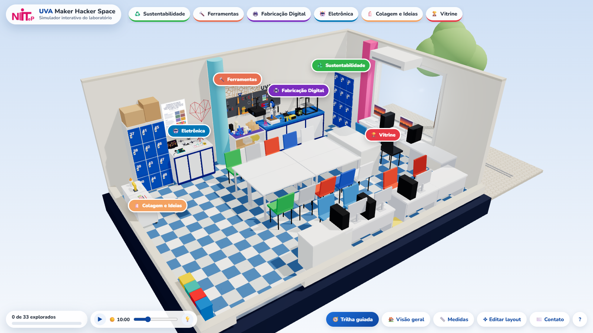
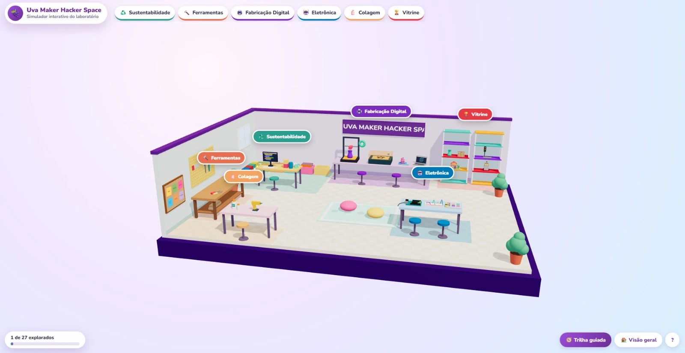
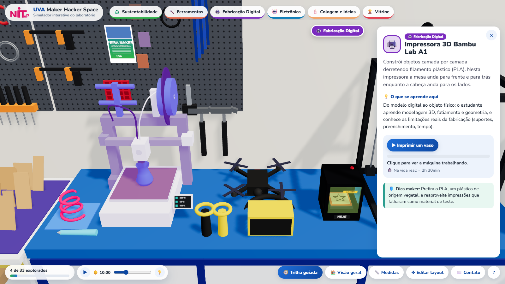
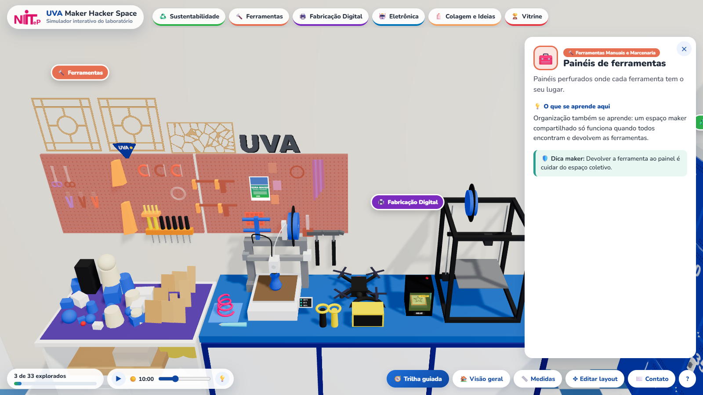
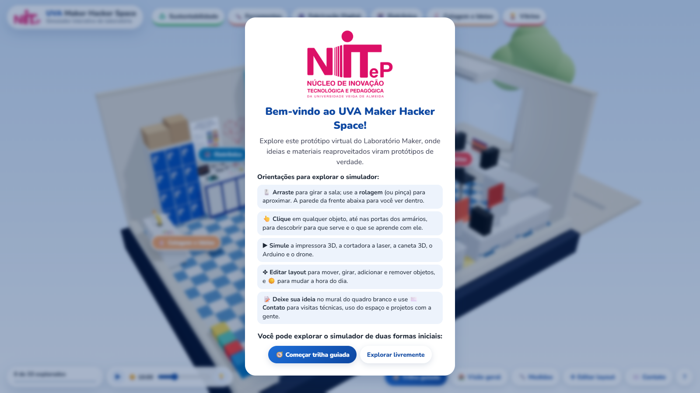
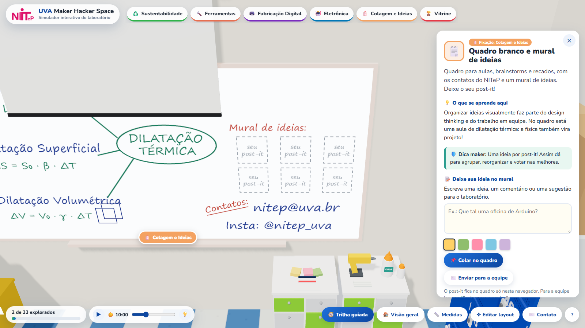

# Simulador 3D do UVA Maker Hacker Space

Versão virtual e interativa do laboratório maker da **Universidade Veiga de Almeida (UVA)**, vinculado ao **NITeP – Núcleo de Inovação Tecnológica e Pedagógica**. Abre direto no navegador, no computador ou no celular, sem instalar nada.

**▶ Abrir o simulador:** https://vwhatrj.github.io/uva-maker-simulador/



## Objetivos

1. **Mostrar como é o espaço** para quem não pode visitar o laboratório presencialmente.
2. **Servir como artefato didático** sobre as tecnologias e os materiais trabalhados no laboratório.
3. **Divulgar o espaço da universidade** em eventos externos.
4. **Tirar dúvidas** sobre tecnologias e ferramentas.

## O que dá para fazer

| Recurso | Descrição |
|---|---|
| Sala 3D navegável | Arrastar gira a sala e a rolagem (ou pinça) aproxima. A parede da frente abaixa para mostrar o interior. |
| 6 estações | Sustentabilidade, Ferramentas, Fabricação Digital, Eletrônica, Colagem e Ideias, e Vitrine. |
| 40 objetos clicáveis | Cada um abre um card com descrição, "o que se aprende aqui" e uma dica maker de segurança. |
| 5 simulações | Impressora 3D, cortadora a laser, caneta 3D, Arduino e drone trabalhando. |
| Trilha guiada | Percurso pelas 6 estações, com contador de objetos explorados. |
| Medidas e hora do dia | Cotas com as medidas reais da sala e ciclo de dia e noite, com sol, sombras e lâmpadas. |
| Editor de layout | Mover, girar, adicionar e remover móveis, com detecção de colisão. O layout pode ser salvo e aberto como arquivo. |
| Mural de ideias | O visitante escreve um post-it, que aparece no quadro branco e é enviado de forma anônima à equipe. |
| Contato | E-mails prontos para uso do espaço, visita técnica e projetos: o professor envia direto ao NITeP, e o aluno envia primeiro ao seu professor. |

## Evolução do projeto

O projeto foi desenvolvido entre **13 e 21 de outubro de 2026** por prototipagem evolutiva: cada versão foi mostrada à equipe do laboratório, e as fotos e os comentários recebidos orientaram a versão seguinte.

### 1. Referência inicial e primeiro protótipo (13/10)

O ponto de partida foi o portfólio de simulações 3D interativas de **Ryan Sael** ([sael.net](https://sael.net/)), referência para a linguagem visual (cenas em formato de diorama, navegáveis no navegador) e para o modelo de interação (clicar nos elementos para obter explicações). No mesmo dia foi feito um teste de viabilidade técnica (um simulador de dispersão da luz num prisma) e o primeiro protótipo do laboratório.

O primeiro protótipo era uma cena estilizada, **sem escala** e com mobiliário genérico, sem correspondência com o laboratório real. Ele validou a estrutura da aplicação, mas mostrou a necessidade de uma referência espacial fiel. Esta captura é o único registro dele:



### 2. Versão em escala real a partir do modelo em SketchUp (14/10)

Com base num modelo do laboratório feito anteriormente no SketchUp e na medida real da sala informada pela coordenação (**7,54 × 5,29 m**), o simulador foi refeito em escala real (1 unidade = 1 metro). Nessa versão vieram as estações, os cards educativos, as simulações, a trilha guiada e o editor de layout. O modelo em SketchUp, porém, estava desatualizado em relação ao arranjo atual da sala.

### 3. Levantamento fotográfico e reconstrução (14/10)

Um levantamento com **21 fotos** do laboratório orientou a reconstrução de cores, piso, mobiliário, colunas, armários, porta da sala A109 e corredor. Os equipamentos reais também foram modelados em tamanho real: as impressoras 3D (incluindo a Bambu Lab A1), a cortadora a laser NEJE e o painel de ferramentas. Medidas que não puderam ser tiradas diretamente foram estimadas por proporção, usando objetos de tamanho conhecido nas fotos.

| Impressora 3D | Painel de ferramentas |
|---|---|
|  |  |

### 4. Validação com a equipe e revisão (14 e 15/10)

A equipe comparou o simulador com o espaço físico e indicou correções por meio de novas fotos e capturas de tela comentadas, como a orientação do armário perto da janela e do balcão do centro. As correções foram publicadas no mesmo ciclo. O conteúdo também foi revisado: peças da vitrine sem autoria confirmada foram retiradas.

### 5. Identidade visual, comunicação e acabamento (21/10)

Entraram o logo do NITeP e os textos da tela de boas-vindas, os contatos do NITeP, o mural de ideias com envio anônimo à equipe e o contato separado para professores e alunos. Os 40 objetos clicáveis foram revisados um por um, e a interface foi ajustada para o celular.

| Tela de boas-vindas | Mural de ideias e contatos |
|---|---|
|  |  |

## Números do projeto

| Item | Valor |
|---|---|
| Medida real da sala | 7,54 × 5,29 m |
| Fotos usadas como referência | 21 |
| Versões publicadas no GitHub | 19 |
| Objetos na sala | 92, sendo 40 clicáveis |
| Estações temáticas | 6 |
| Simulações de máquinas | 5 |
| Linhas de código (HTML, CSS e JavaScript) | cerca de 3.500 |

## Tecnologias

- **HTML, CSS e JavaScript**, sem frameworks e sem etapa de compilação.
- **[Three.js](https://threejs.org/) 0.160** para o 3D no navegador (WebGL).
- **Modelos 3D feitos em código**, com formas simples, sem arquivos 3D externos.
- **Git, GitHub e GitHub Pages** para versionamento e publicação.
- **Formulários e Planilhas Google** para o registro anônimo de visitas e post-its.

## Privacidade

O simulador não reproduz os nomes que aparecem nos armários do laboratório. O registro de uso é anônimo: conta as visitas e recebe os post-its sem guardar nome, e-mail, endereço IP ou outros dados pessoais, e a tela inicial avisa o visitante sobre isso.

## Uso de inteligência artificial

O simulador foi desenvolvido com o apoio do assistente de inteligência artificial **Claude**, da Anthropic, e, a partir da versão em escala real, do **Claude Code**. A equipe do projeto definiu os objetivos, tirou as fotos, informou as medidas, decidiu o conteúdo e validou cada versão. O assistente escreveu o código, modelou a sala a partir das fotos e testou cada mudança no navegador antes da publicação.

## Créditos

- **Desenvolvimento:** Guilherme
- **Orientação:** Prof. Thiago, NITeP – UVA
- **Referência inicial:** Ryan Sael ([sael.net](https://sael.net/))
- **Contato do NITeP:** nitep@uva.br · Instagram [@nitep_uva](https://www.instagram.com/nitep_uva/)

---

## Para quem vai continuar o projeto

### Abrir no próprio computador

Dê dois cliques em `index.html`. Precisa de internet, porque a biblioteca Three.js vem de um CDN. Abrindo assim, as visitas e os post-its não são enviados para a planilha.

### Continuar em outro computador

1. No GitHub Desktop: **File → Clone repository** e escolha `uva-maker-simulador`.
2. Abra a pasta no VS Code com o Claude Code e peça o que quiser mudar.
3. Ao terminar: **Commit to main** e **Push origin** no GitHub Desktop. O site atualiza sozinho em 1 ou 2 minutos.

### Estrutura

| Arquivo | O que tem |
|---|---|
| `js/dados.js` | **Todo o conteúdo**: estações, catálogo de tipos de objeto, objetos da sala, contatos e configuração do formulário |
| `js/modelos.js` | Os modelos 3D (feitos em código) e as animações das máquinas |
| `js/app.js` | Cena, câmera, cards, trilha, simulações, edição de layout, hora do dia, mural e contato |
| `css/estilo.css` | Visual da interface |
| `img/` | Logo do NITeP |
| `docs/` | Imagens desta página |

Links diretos: `#impressora-3d` (um objeto), `#eletronica` (uma estação), `#medidas`.

Ao mudar a posição de objetos em `js/dados.js`, troque também a data em `layoutPadrao`: assim os layouts antigos salvos nos navegadores voltam ao padrão.

### Como adicionar um tipo de objeto novo ao catálogo

Em `js/dados.js`, dentro de `catalogo`:

```js
furadeira: {
  categoria: 'Equipamentos', nome: 'Furadeira', icone: '🔩',
  modelo: 'generico', opcoes: { cor: '#e76f51', tamanho: [0.3, 0.2, 0.1] },
  base: [0.3, 0.1],          // espaço que ocupa (largura x profundidade, em metros)
  apoio: 'ambos',            // 'chao', 'superficie' ou 'ambos'
  zona: 'ferramentas', descricao: '...', aprender: '...', dica: '...'
}
```

Ele aparece no botão **➕ Adicionar objeto**. Para colocá-lo na sala desde o início, acrescente em `objetos`:
`{ id: 'furadeira-1', tipo: 'furadeira', pos: [x, y, z], sobre: 'balcao-fabricacao' }`.
A sala vai de x -3,77 a 3,77 e de z -2,645 a 2,645; y = 0,9 é o tampo dos balcões.

### Medidas estimadas

Pé-direito (3,00 m), peitoril da janela (0,80 m) e largura da porta dupla (1,50 m) foram estimados pelas fotos.
